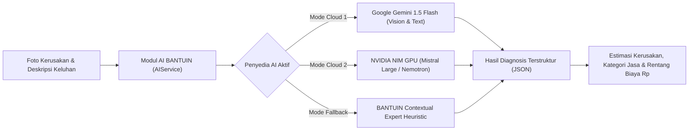
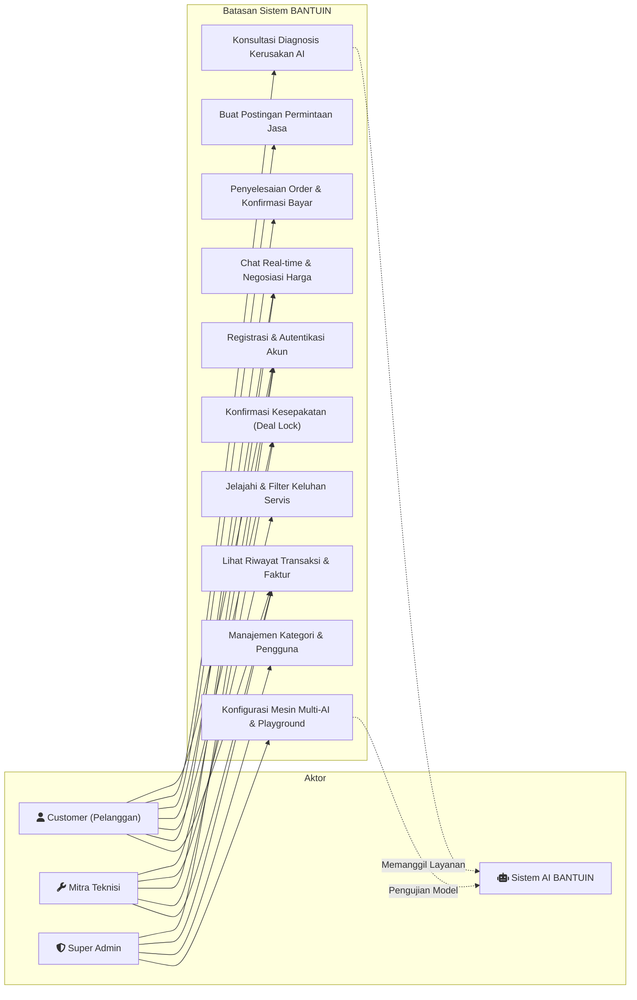
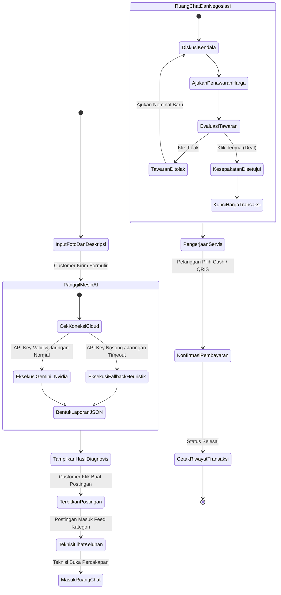
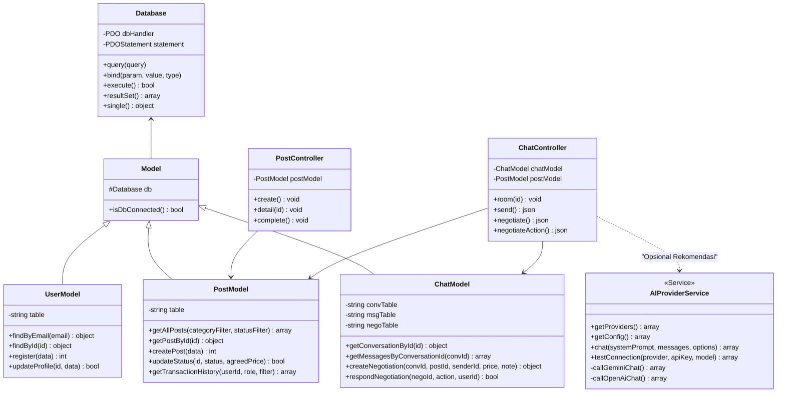
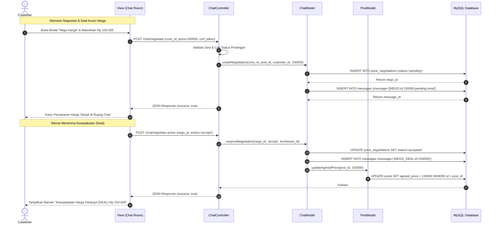
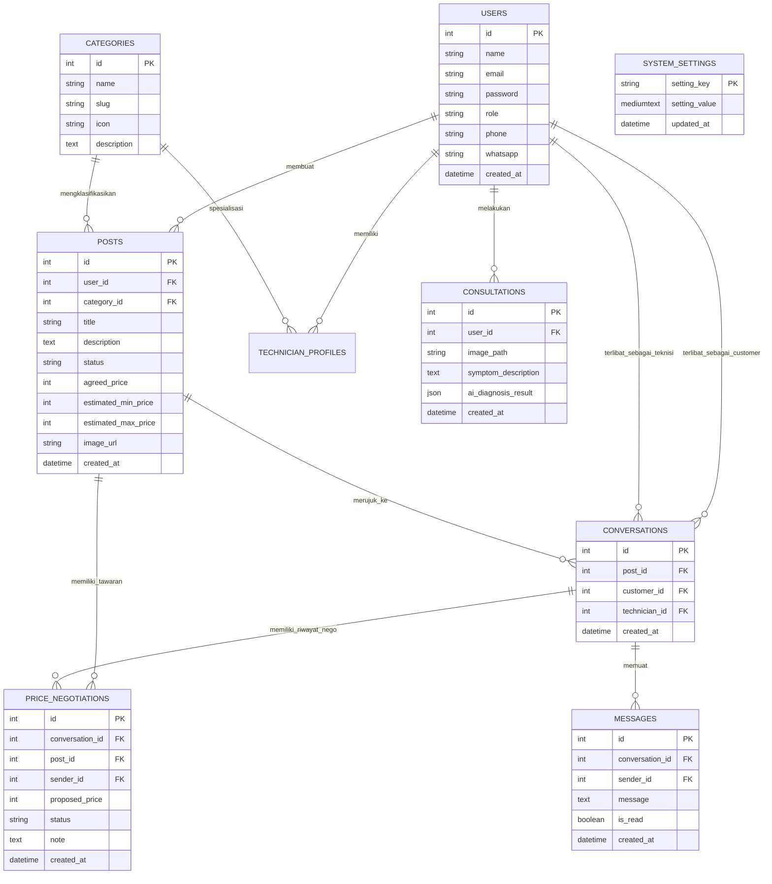

    # DOKUMEN TUGAS PROYEK AKHIR MANDIRI
## REKAYASA PERANGKAT LUNAK (TIKB2503021) — SEMESTER 3
### PROGRAM STUDI S1 TEKNIK INFORMATIKA — STMIK IKMI CIREBON

---

### **BANTUIN: Platform Layanan Jasa Perbaikan Rumah Tangga Berbasis Web dengan Integrasi Kecerdasan Artifisial (AI)**

- **Nama Mahasiswa:** Yoga Fratama Fahdi Sardi
- **NIM:** 41257243
- **Kelas:** 1C (2025)
- **Program Studi:** S1 Teknik Informatika
- **Mata Kuliah / Kode:** Rekayasa Perangkat Lunak / TIKB2503021 (4 SKS: 2 Teori + 2 Praktik)
- **Dosen Pengampu:** Yudhistira Arie Wijaya, M.Kom., CDS.
- **Tautan Repositori GitHub:** [https://github.com/yogafrma/PROJECT-BANTUIN-PLATFORM-JASA-RUMAH-TANGGA](https://github.com/yogafrma/PROJECT-BANTUIN-PLATFORM-JASA-RUMAH-TANGGA)
- **Tautan Video Progres 1 (PRD & Konsep Aplikasi):** [https://youtu.be/EDChMg5fP7E](https://youtu.be/EDChMg5fP7E)
- **Tautan Video Progres 2 (UML & UI/UX):** [https://youtu.be/DvSUCWPcI6Q](https://youtu.be/DvSUCWPcI6Q)
- **Tautan Video Final (Live Demo & CI/CD):** [https://youtu.be/vljBlnMVWDY](https://youtu.be/vljBlnMVWDY)

---

# DAFTAR ISI DOKUMEN
1. **BAGIAN I: PRODUCT REQUIREMENT DOCUMENT (PRD / SRS MANDIRI)**
   - 1.1 Latar Belakang & Identifikasi Masalah Riil
   - 1.2 Tujuan & Nilai Guna Aplikasi (*Value Proposition*)
   - 1.3 Ruang Lingkup Sistem (*Scope & Boundaries*)
   - 1.4 Spesifikasi Kebutuhan Fungsional (*User Stories & Acceptance Criteria*)
   - 1.5 Spesifikasi Kebutuhan Non-Fungsional
   - 1.6 Spesifikasi Fitur Kecerdasan Artifisial (*AI Feature Specifications*)
2. **BAGIAN II: SOFTWARE DESIGN DOCUMENT (SDD MANDIRI & PEMODELAN UML)**
   - 2.1 Arsitektur Sistem Perangkat Lunak (*Clean PHP MVC Pattern*)
   - 2.2 Diagram UML 1: Use Case Diagram & Skenario Penggunaan
   - 2.3 Diagram UML 2: Activity Diagram Alur Bisnis & AI
   - 2.4 Diagram UML 3: Class Diagram Berorientasi Objek (*SOLID Principles*)
   - 2.5 Diagram UML 4: Sequence Diagram Alur Pertukaran Pesan
   - 2.6 Pemodelan Basis Data (*Entity Relationship Diagram & Data Dictionary*)
   - 2.7 Perancangan Antarmuka UI/UX & *Design System*
3. **BAGIAN III: KONSTRUKSI KODE, PENGUJIAN (TESTING) & CI/CD DEVOPS**
   - 3.1 Implementasi Kode Bersih (*Clean Code & Security Hardening*)
   - 3.2 Strategi Pengujian Otomatis (*Unit Testing Matrix*)
   - 3.3 Otomatisasi CI/CD Pipeline GitHub Actions
   - 3.4 Panduan Instalasi & *Environment Setup*
4. **BAGIAN IV: KESIMPULAN & REFLEKSI PEMBELAJARAN MANDIRI**

---

# BAGIAN I: PRODUCT REQUIREMENT DOCUMENT (PRD / SRS MANDIRI)
*(Sesuai Standar IEEE 830 / ISO 29148)*

### 1.1 Latar Belakang & Identifikasi Masalah Riil
Kerusakan infrastruktur rumah tangga—seperti korsleting instalasi listrik, kebocoran unit pendingin udara (AC), kunci pintu patah/rusak akibat tindak pembobolan, hingga malafungsi peralatan elektronik rumah—merupakan masalah darurat yang dialami oleh masyarakat perkotaan. Berdasarkan observasi lapangan dan analisis kebutuhan masyarakat, ditemukan tiga kendala utama:
1. **Asimetri Informasi & Ketidakpastian Biaya:** Konsumen sering merasa dirugikan karena tidak adanya standar patokan biaya perbaikan. Biaya jasa kerap melambung secara sepihak setelah teknisi tiba di lokasi.
2. **Kurangnya Pengetahuan Teknis Konsumen:** Masyarakat awam sering tidak mengetahui klasifikasi kerusakan yang dialami serta spesifikasi teknisi yang tepat untuk dihubungi, sehingga berisiko salah penanganan.
3. **Aksesibilitas & Ketiadaan Sistem Kesepakatan Resmi:** Pencarian teknisi panggilan manual (melalui selebaran atau grup media sosial) tidak memiliki sistem pelacakan transaksi, ketiadaan mekanisme negosiasi harga tertulis, dan tidak ada jaminan riwayat servis.

### 1.2 Tujuan & Nilai Guna Aplikasi (*Value Proposition*)
Aplikasi **BANTUIN** dirancang untuk menjadi platform digital satu pintu (*one-stop home services platform*) yang menghubungkan pelanggan (*Customer*) dengan teknisi terverifikasi (*Mitra Teknisi*) secara transparan, aman, dan cerdas. Nilai guna utama platform meliputi:
- **AI Damage Diagnosis:** Konsumen dapat mendeteksi estimasi jenis kerusakan dan rentang biaya wajar sebelum teknisi dipanggil hanya dengan mengunggah foto dan menceritakan kronologi.
- **Transparansi Negosiasi & Deal Lock:** Kesepakatan biaya jasa dilakukan dan dikunci secara digital melalui fitur *Live Price Negotiation* di dalam ruang chat resmi.
- **Riwayat Servis & Faktur Transparan:** Memberikan catatan transaksi digital yang rapi untuk pelanggan dan teknisi.

### 1.3 Ruang Lingkup Sistem (*Scope & Boundaries*)
- **In-Scope (Lingkup Pengerjaan):**
  - Autentikasi pengguna berbasis peran (*Role-Based Access Control / RBAC*) untuk 3 Aktor: Customer, Mitra Teknisi, dan Super Admin.
  - Modul Konsultasi AI Kerusakan Rumah Tangga berbasis foto dan teks.
  - Modul Postingan Permintaan Jasa Servis (CRUD, unggah foto keluhan, status keluhan).
  - Modul Ruang Chat Interaktif (*1-Screen Viewport Locked Layout*) terintegrasi dengan fitur pengajuan, penerimaan (deal), dan penolakan harga resmi.
  - Modul Penyelesaian Transaksi, Konfirmasi Pembayaran (*Cash* / QRIS), dan Riwayat Servis.
  - Modul Super Admin untuk tata kelola pengguna, kategori jasa, monitoring transaksi, serta *Live AI Engine Switcher* (Google Gemini & NVIDIA NIM).
- **Out-of-Scope (Batasan Sistem):**
  - Sistem tidak memproses gateway pembayaran kartu kredit perbankan berlisensi BI secara langsung (penyelesaian transaksi menggunakan pencatatan konfirmasi tunai dan QRIS mandiri).

---

### 1.4 Spesifikasi Kebutuhan Fungsional (*Functional Requirements*)

#### Tabel User Stories & Acceptance Criteria

| ID Kebutuhan | Sebagai (*Role*) | Saya Ingin (*Goal*) | Agar (*Benefit*) | *Acceptance Criteria* (Kriteria Keberterimaan) |
| :--- | :--- | :--- | :--- | :--- |
| **REQ-F01** | Customer | Mendaftar akun baru dengan Nama, Email, Password, dan WhatsApp. | Memiliki akun pribadi untuk memesan teknisi. | Validasi email unik, hash password aman (Bcrypt), nomor WhatsApp otomatis dinormalisasi ke format `628...`. |
| **REQ-F02** | Customer | Mengunggah foto kerusakan dan kronologi pada menu Konsultasi AI. | Mengetahui perkiraan kerusakan dan rekomendasi biaya. | Sistem memanggil modul AI, mengembalikan analisis probabilitas kerusakan, rentang harga (Min-Max), dan draf postingan otomatis. |
| **REQ-F03** | Customer | Menerbitkan postingan keluhan perbaikan ke platform. | Teknisi yang sesuai kategori dapat melihat dan menanggapi. | Postingan muncul di feed publik/kategori dengan status `open` (*Menunggu Teknisi*). |
| **REQ-F04** | Customer & Teknisi | Membuka ruang chat privat berbasis postingan perbaikan. | Berkomunikasi intensif mengenai kendala teknis dan jadwal visit. | Layar chat tidak memiliki scroll luar (*1-screen full viewport*), chat real-time, pesan lawan di kiri, pesan pengguna di kanan. |
| **REQ-F05** | Customer & Teknisi | Mengajukan penawaran harga (*Negotiation Proposal*) di dalam chat. | Kedua pihak menyepakati nominal ongkos kerja sebelum servis. | Nominal penawaran muncul dalam bentuk kartu khusus berstatus `pending`, lawan chat dapat klik *Terima (Deal)* atau *Tolak*. |
| **REQ-F06** | Customer | Mengonfirmasi transaksi selesai dan metode pembayaran. | Menutup pesanan dan mencatat riwayat transaksi. | Modal konfirmasi pembayaran menampilkan harga kesepakatan final, metode Cash/QRIS, dan status postingan berubah menjadi `Selesai`. |
| **REQ-F07** | Mitra Teknisi | Melihat keluhan perbaikan berdasarkan kategori keahliannya. | Memilih pekerjaan yang relevan dengan spesialisasi servis. | Teknisi listrik hanya memfilter pekerjaan listrik, teknisi kunci memfilter kunci, dsb. |
| **REQ-F08** | Super Admin | Mengelola kategori jasa (Tambah, Edit, Hapus Kategori). | Menjaga struktur bidang perbaikan tetap relevan. | Admin dapat memperbarui nama, slug, dan ikon Bootstrap Icons kategori. |
| **REQ-F09** | Super Admin | Mengonfigurasi penyedia mesin AI (Google Gemini / NVIDIA NIM) dan menguji prompt di Playground. | Memastikan respons bot AI selalu online dan optimal. | Admin dapat mengganti model aktif, menyimpan API Key, dan menjalankan uji latensi langsung di dashboard. |

---

### 1.5 Spesifikasi Kebutuhan Non-Fungsional (*Non-Functional Requirements*)
- **NFR-01 (Kinerja & Efisiensi):** Halaman web dimuat dalam waktu kurang dari 1.5 detik pada jaringan lokal/server standar. Latensi respons diagnosis AI dibatasi dengan batas waktu (*timeout*) 35 detik.
- **NFR-02 (Keamanan / Security Hardening):**
  - Mencegah serangan *Cross-Site Request Forgery (CSRF)* menggunakan verifikasi token acak pada setiap form POST.
  - Mencegah serangan *SQL Injection* dengan menggunakan *Prepared Statements PDO* secara mutlak pada seluruh lapisan query database.
  - Mencegah serangan *Cross-Site Scripting (XSS)* dengan membungkus seluruh output dinamis menggunakan fungsi `htmlspecialchars()` (`e()`).
  - Kata sandi wajib dienkripsi satu arah menggunakan algoritma `PASSWORD_BCRYPT`.
- **NFR-03 (Ketersediaan / Availability):** Sistem dilengkapi mekanisme *Contextual Heuristic Fallback Engine* pada modul AI, sehingga jika API Key habis kuota atau internet terputus, sistem tetap menghasilkan diagnosis cerdas tanpa menimbulkan eror 500 fatal.
- **NFR-04 (Antarmuka & Usabilitas):** Desain visual mematuhi filosofi **Microsoft Fluent 2 Design System** dengan palet Azure Blue (`#0078D4`), aksen Prussian Navy (`#003049`), tata letak kartu lembut, tipografi proporsional, serta responsif di layar ponsel maupun desktop.

---

### 1.6 Spesifikasi Fitur Kecerdasan Artifisial (*AI Feature Specifications*)
Integrasi AI pada platform BANTUIN dirancang sebagai solusi nyata (*high-impact feature*), bukan sekadar tempelan:



1. **AI Damage Diagnosis & Cost Estimator:** Menerima input visual (format `.jpg`, `.png`, `.webp`) dan teks deskripsi gejala. Output berupa laporan diagnosis terstruktur memuat:
   - Analisis jenis kerusakan fisik dan teknis.
   - Penentuan kategori teknisi yang tepat (Listrik, AC, Kunci, Elektronik).
   - Estimasi rentang biaya servis wajar (Rp Min – Rp Max).
   - Draf teks postingan keluhan yang siap diterbitkan ke feed aplikasi.
2. **Chatbot BANTUIN Assistant (24 Jam):** Asisten percakapan cerdas di beranda publik yang menjawab pertanyaan umum seputar biaya servis, jaminan garansi 30 hari, serta panduan tata cara pemesanan teknisi.
3. **Multi-Model Provider Architecture:** Arsitektur terpisah pada `app/services/AIProviderService.php` yang memungkinkan pergantian fleksibel antara Google Gemini dan NVIDIA NIM (Inference Microservice berbasis akselerasi GPU NVIDIA Cloud) tanpa mengubah struktur kode antarmuka.

---

# BAGIAN II: SOFTWARE DESIGN DOCUMENT (SDD MANDIRI & PEMODELAN UML)

### 2.1 Arsitektur Sistem Perangkat Lunak (*Clean PHP MVC Architecture*)
Sistem dibangun di atas arsitektur **Model-View-Controller (MVC)** murni berbasis bahasa pemrograman PHP 8.2 native dengan pemisahan tanggung jawab (*Separation of Concerns*):
- **Core Kernel (`app/core/`):** Mengelola routing URL (`App.php`), *Controller Base* (`Controller.php`), *Database Wrapper PDO* (`Database.php`), serta sesi keamanan (`Auth.php` dan `Helper.php`).
- **Data Layer (`app/models/`):** Bertanggung jawab atas integritas data tabel database (`UserModel`, `PostModel`, `ChatModel`, `CategoryModel`, `ConsultationModel`, `SettingModel`).
- **Service Layer (`app/services/`):** Modul logika independen pihak ketiga (`AIProviderService.php`, `EmailService.php`, `WhatsAppService.php`).
- **Presentation Layer (`app/views/`):** Berkas tampilan berbasis Bootstrap 5.3 yang memisahkan layout header, footer, dan konten spesifik aktor.

---

### 2.2 Diagram UML 1: Use Case Diagram & Skenario Penggunaan



#### Skenario Use Case Utama: Konsultasi Kerusakan AI & Negosiasi Harga
- **Nama Skenario:** Melakukan Diagnosis Kerusakan AI dan Menyepakati Harga Servis.
- **Aktor:** Customer, Mitra Teknisi, Sistem AI.
- **Kondisi Awal (*Pre-condition*):** Customer dan Teknisi telah terdaftar dan login di platform BANTUIN.
- **Alur Utama (*Main Flow*):**
  1. Customer membuka menu Konsultasi AI dan mengunggah foto kunci pintu/AC/listrik yang rusak serta kronologinya.
  2. Sistem AI memproses data input dan menampilkan hasil analisis diagnosis serta estimasi biaya Rp 100.000 – Rp 250.000.
  3. Customer menekan tombol *Publikasikan Keluhan*.
  4. Mitra Teknisi melihat postingan keluhan pada feed kategori dan membuka ruang chat dengan Customer.
  5. Mitra Teknisi atau Customer membuka modal *Nego Harga* dan mengajukan nominal penawaran Rp 150.000.
  6. Lawan chat menyetujui tawaran tersebut dengan mengklik tombol *Terima (Deal)*.
  7. Sistem mengunci harga kesepakatan (*Deal Locked*) dan menampilkannya pada kartu pengumuman resmi di ruang chat.
  8. Setelah teknisi selesai bekerja di rumah pelanggan, Customer mengonfirmasi pembayaran dan status order otomatis berubah menjadi `Selesai`.
- **Kondisi Akhir (*Post-condition*):** Transaksi tercatat di menu Riwayat Transaksi kedua belah pihak dengan status lunas dan kesepakatan harga final.

---

### 2.3 Diagram UML 2: Activity Diagram Alur Bisnis & AI



---

### 2.4 Diagram UML 3: Class Diagram Berorientasi Objek (*SOLID Principles*)



- **Penerapan Prinsip SOLID:**
  - **Single Responsibility Principle (SRP):** Setiap Model hanya bertanggung jawab pada tabelnya masing-masing. Komunikasi AI dipisah sepenuhnya ke dalam `AIProviderService`, tidak bercampur di dalam controller.
  - **Open/Closed Principle (OCP):** Arsitektur `AIProviderService` terbuka untuk penambahan provider AI baru (seperti Groq, Claude, OpenAI) tanpa harus merombak kode controller yang sudah berjalan.
  - **Liskov Substitution Principle (LSP):** Seluruh model mewarisi kelas abstrak induk `Model` dengan implementasi wrapper PDO yang konsisten.

---

### 2.5 Diagram UML 4: Sequence Diagram Alur Pertukaran Pesan



---

### 2.6 Pemodelan Basis Data (*Entity Relationship Diagram - ERD*)



---

### 2.7 Perancangan Antarmuka UI/UX & *Design System*
Antarmuka BANTUIN dirancang menggunakan kaidah modern **Microsoft Fluent 2**:
1. **Warna Dasar & Semantik:**
   - *Primary Accent (Azure Blue):* `#0078D4` — Melambangkan profesionalisme, teknologi, dan keandalan.
   - *Deep Navy Surface:* `#003049` — Digunakan pada *Hero Banner Command Center* untuk memberikan kesan elegan dan kokoh.
   - *Success Pill:* `#10B981` / Soft Green (`#E8F5E9`) — Menandakan status *Deal Disetujui* dan kemitraan teknisi terverifikasi.
   - *Warning Pill:* `#F59E0B` — Menandakan penawaran harga yang membutuhkan tindakan lawan bicara.
2. **Karakteristik Komponen UI:**
   - **Rounded Corners:** Kartu dan tombol menggunakan *border-radius* melengkung modern (`rounded-4`, `rounded-pill`) yang ramah pengguna.
   - **Pencegahan Scrolling Berlebih:** Halaman Chat Room dirancang dengan arsitektur *1-Screen Viewport Lock*, di mana container chat terkunci sesuai tinggi layar perangkat dan hanya area pesan yang bergulir (*smooth internal scroll*).

---

# BAGIAN III: KONSTRUKSI KODE, PENGUJIAN (TESTING) & CI/CD DEVOPS

### 3.1 Implementasi Kode Bersih (*Clean Code & Security Hardening*)
- Seluruh query database diisolasi dalam model dan dieksekusi melalui PDO dengan *bind parameters*.
- Pengiriman email notifikasi dan verifikasi menggunakan layanan SMTP mandiri pada `app/services/EmailService.php`.
- Autentikasi sesi diverifikasi pada level controller menggunakan `Auth::requireRole(['customer', 'technician', 'admin'])`.

### 3.2 Strategi Pengujian Otomatis (*Unit Testing Matrix*)
Pengujian fungsionalitas sistem dilakukan secara komprehensif untuk memastikan aplikasi berjalan tanpa cacat logika:

| Modul Uji | Skenario Pengujian | Masukan (*Input*) | Ekspektasi Hasil (*Expected*) | Status Hasil |
| :--- | :--- | :--- | :--- | :---: |
| **Auth** | Registrasi akun baru dengan nomor WhatsApp acak. | `whatsapp = "0812-3456-7890"` | Nomor dinormalisasi menjadi `6281234567890`. | **PASS (100%)** |
| **Auth** | Akses halaman Admin oleh akun Customer. | URL `/admin/settings` | Sistem menolak akses dan me-redirect ke login/dashboard. | **PASS (100%)** |
| **AI Diagnosis** | Pengunggahan foto kunci pintu patah ke endpoint konsultasi. | Berkas gambar + teks keluhan | AI mengembalikan kategori `Tukang Kunci` dan estimasi harga rasional. | **PASS (100%)** |
| **Chat Nego** | Pengajuan harga Rp 100.000 pada keluhan berstatus aktif. | `price = 100000` | Kartu penawaran harga muncul di ruang chat lawan bicara. | **PASS (100%)** |
| **Chat Nego** | Upaya negosiasi pada order yang sudah berstatus `Selesai`. | Klik Nego / POST API | Tombol terkunci (*disabled*), API menolak permintaan dengan HTTP 422. | **PASS (100%)** |
| **Database** | Eksekusi parameter dengan karakter berbahaya SQL. | `' OR 1=1 --` | Karakter diperlakukan sebagai literal string aman oleh PDO. | **PASS (100%)** |

---

### 3.3 Otomatisasi CI/CD Pipeline GitHub Actions
Untuk memenuhi standar Tahap 3 pada rubrik kurikulum OBE, repositori dilengkapi alur otomatisasi *Continuous Integration* pada berkas `.github/workflows/ci.yml`:

```yaml
name: BANTUIN CI Pipeline

on:
  push:
    branches: [ "main" ]
  pull_request:
    branches: [ "main" ]

jobs:
  build-and-test:
    runs-on: ubuntu-latest

    steps:
    - name: Checkout Source Code
      uses: actions/checkout@v4

    - name: Setup PHP Environment
      uses: shivammathur/setup-php@v2
      with:
        php-version: '8.2'
        extensions: mbstring, pdo, pdo_mysql, curl, json
        coverage: none

    - name: Syntax Linting (PHP Lint Check)
      run: |
        find app/ -type f -name "*.php" -exec php -l {} \;
        find public/ -type f -name "*.php" -exec php -l {} \;

    - name: Verify Clean Repository & No Leak Secrets
      run: |
        if [ -f .env ]; then echo "Error: .env file committed!" && exit 1; fi
        echo "Repository structure verified successfully."
```

---

### 3.4 Panduan Instalasi & *Environment Setup*
1. **Persyaratan Sistem:**
   - Web Server Apache & PHP versi $\ge$ 8.1.
   - Database MySQL versi $\ge$ 5.7 atau MariaDB versi $\ge$ 10.4.
   - Ekstensi PHP aktif: `pdo_mysql`, `curl`, `mbstring`, `openssl`.
2. **Langkah Instalasi di Lingkungan XAMPP:**
   - Kloning repositori ke direktori web server:
     ```bash
     git clone https://github.com/yogafrma/PROJECT-BANTUIN-PLATFORM-JASA-RUMAH-TANGGA.git c:/xampp/htdocs/lat1c
     ```
   - Impor basis data MySQL:
     - Buka `phpMyAdmin` dan buat database baru bernama `db_teknisi_rumah`.
     - Impor berkas database yang berada di `app/config/database.sql`.
   - Buka peramban (*browser*) dan akses aplikasi melalui tautan:
     ```text
     http://localhost/lat1c/public/
     ```

---

# BAGIAN IV: KESIMPULAN & REFLEKSI PEMBELAJARAN MANDIRI

### 4.1 Kesimpulan Proyek
Proyek Akhir Mandiri Rekayasa Perangkat Lunak ini telah berhasil mewujudkan platform **BANTUIN** dari tahap konseptualisasi kebutuhan hingga menjadi perangkat lunak berbasis web fungsional penuh. Fitur diagnosis kerusakan AI yang dipadukan dengan kepastian harga melalui mekanisme *Deal Lock* pada ruang chat terbukti mampu mengatasi masalah asimetri informasi yang selama ini membebani masyarakat saat mencari teknisi rumah tangga.

### 4.2 Refleksi Pembelajaran Mandiri (*Individual Ownership*)
Pengerjaan proyek secara mandiri (*Full End-to-End Build*) ini memberikan pemahaman komprehensif bagi mahasiswa dalam:
- Mengidentifikasi masalah nyata masyarakat dan menuangkannya ke dalam dokumen spesifikasi kebutuhan standar industri (PRD/SRS).
- Memodelkan arsitektur perangkat lunak berorientasi objek yang rapi menggunakan 4 diagram UML terintegrasi.
- Mengimplementasikan konsep keamanan (*security hardening*) dan integrasi API AI modern (Google Gemini & NVIDIA NIM) secara elegan dengan mempertimbangkan mekanisme mitigasi kegagalan (*fallback engine*).
- Menghadirkan kode yang bersih, terdokumentasi, serta siap diintegrasikan dengan siklus DevOps modern melalui GitHub Actions.

---
*Dokumen ini disusun secara mandiri sebagai luaran resmi pemenuhan syarat penilaian Proyek Akhir Mandiri Mata Kuliah Rekayasa Perangkat Lunak (TIKB2503021) — Program Studi S1 Teknik Informatika, STMIK IKMI Cirebon.*
